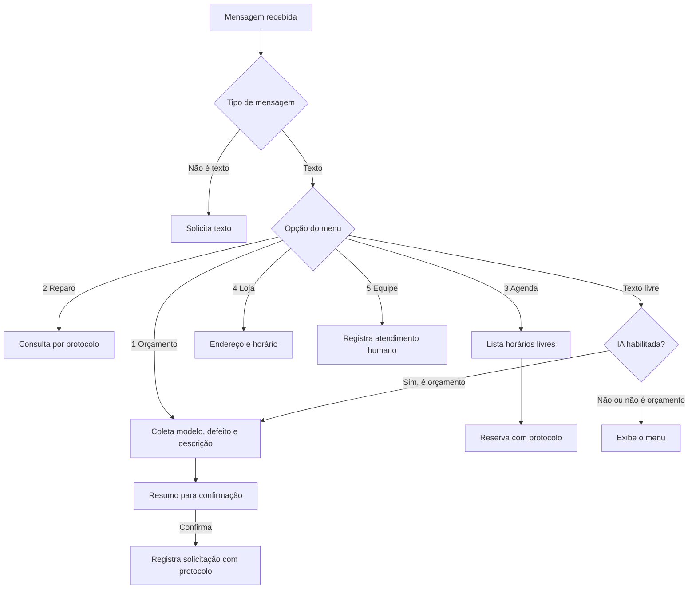
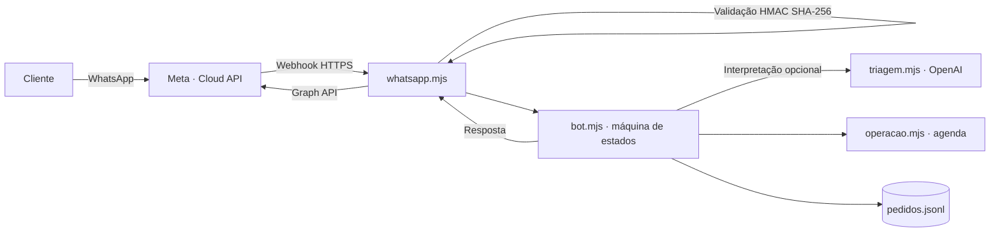

# Conserta Fácil | Chatbot de Atendimento via WhatsApp

  
  
  
  

  
  
  

  
  
  
  
  

  Chatbot de atendimento para uma assistência técnica de celulares, com fluxos de orçamento, acompanhamento
  de reparo, agendamento de entrega, consulta de informações da loja e encaminhamento para a equipe.
  Opera pela API oficial do WhatsApp e pode interpretar mensagens em texto livre com IA.

  <a href="#-visão-geral">Visão geral</a> •
  <a href="#-funcionalidades">Funcionalidades</a> •
  <a href="#-fluxo-de-atendimento">Fluxo</a> •
  <a href="#-arquitetura">Arquitetura</a> •
  <a href="#-decisões-técnicas">Decisões técnicas</a> •
  <a href="#-tecnologias">Tecnologias</a>

---

## 📌 Visão geral

O **Conserta Fácil** é um projeto de portfólio que simula o atendimento inicial de uma assistência técnica de celulares.
O cliente conversa pelo WhatsApp, solicita um orçamento, acompanha um reparo, reserva um horário para entrega e
é encaminhado à equipe quando necessário. Todos os dados da loja, dos aparelhos e dos clientes são fictícios.

| ❌ Problema | 💡 Solução | ✅ Resultado |
|---|---|---|
| Mensagens sobre orçamento chegam fora do horário e sem um padrão de informações. | Fluxo guiado que coleta modelo, tipo de defeito e descrição antes de registrar a solicitação. | Cada pedido chega à equipe completo, com protocolo. |
| O cliente precisa perguntar o andamento do reparo por mensagem. | Consulta de status pelo protocolo, restrita ao remetente que fez o pedido. | Informações do reparo disponíveis sem intervenção da equipe. |
| Agendar a entrega exige troca de mensagens até encontrar um horário livre. | Lista de horários disponíveis; o horário reservado deixa de ser oferecido. | Reserva confirmada com protocolo em poucas etapas. |
| Clientes escrevem o problema em texto livre, de forma variada. | IA extrai modelo, defeito e descrição; o bot pede apenas o que falta e exibe um resumo para confirmação. | Registro somente após confirmação explícita do cliente. |

## ⚙️ Funcionalidades

| Função | Comportamento |
|---|---|
| **Solicitar orçamento** | Coleta modelo, tipo de defeito e descrição, exibe um resumo e registra a solicitação após confirmação. O valor é definido pela equipe após avaliação do aparelho. |
| **Acompanhar reparo** | Consulta o status, o modelo e a descrição de um pedido a partir do protocolo, somente para o remetente que o criou. |
| **Agendar entrega** | Oferece até três horários livres nos próximos dias úteis. Cada horário é reservado uma única vez. |
| **Endereço e horário** | Apresenta a localização de referência e o horário de atendimento da loja. |
| **Falar com a equipe** | Registra uma solicitação de atendimento humano com o assunto informado pelo cliente. |
| **Interpretação com IA** | Quando habilitada, identifica a intenção de orçamento em uma mensagem livre e extrai os dados do aparelho. |

## 🔄 Fluxo de atendimento

## 🏗️ Arquitetura

| Módulo | Responsabilidade |
|---|---|
| `bot.mjs` | Máquina de estados das conversas, regras de cada etapa e registro dos pedidos. |
| `whatsapp.mjs` | Recebimento de eventos do webhook, validação de assinatura, controle de entregas e envio de respostas. |
| `triagem.mjs` | Chamada à API da OpenAI com saída em JSON Schema, para extrair dados de texto livre. |
| `operacao.mjs` | Agenda de horários, com reserva atômica por arquivo. |

## 🧭 Decisões técnicas

- **Confirmação antes do registro.** A IA apenas sugere os dados. Nenhum pedido é gravado sem a confirmação do cliente.
- **Valor fora do bot.** O sistema não estima preço. A avaliação do aparelho é responsabilidade da equipe.
- **Validação da origem do webhook.** Cada evento é aceito somente com assinatura HMAC SHA-256 válida, comparada em tempo constante.
- **Idempotência por mensagem.** Entregas já enviadas não são repetidas se a Meta reenviar o mesmo evento.
- **Fila por cliente.** Mensagens de um mesmo remetente são processadas em ordem, sem respostas cruzadas.
- **Fallback sem IA.** Se a API estiver indisponível ou não configurada, o fluxo guiado continua funcionando.
- **Dependências mínimas.** O projeto usa somente os módulos nativos do Node.js.
- **Dados fora do repositório.** Pedidos, reservas e credenciais são mantidos localmente e excluídos do controle de versão.

## 🛠️ Tecnologias

| Categoria | Tecnologias |
|---|---|
| Linguagem e runtime | JavaScript (ES Modules), Node.js |
| Integração | WhatsApp Cloud API (Meta), webhooks, Graph API |
| IA | OpenAI Responses API, saída estruturada com JSON Schema |
| Segurança | HMAC SHA-256, comparação em tempo constante |
| Armazenamento | Arquivos JSON Lines e agenda em arquivos |
| Versionamento | Git, GitHub |

