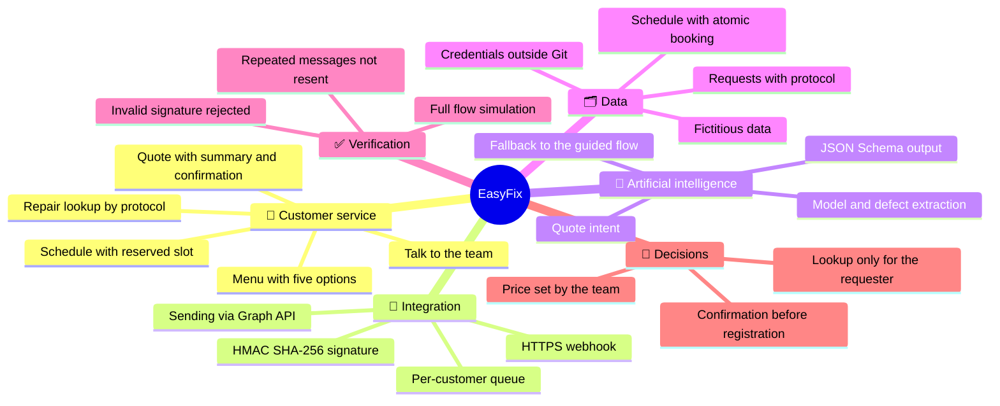
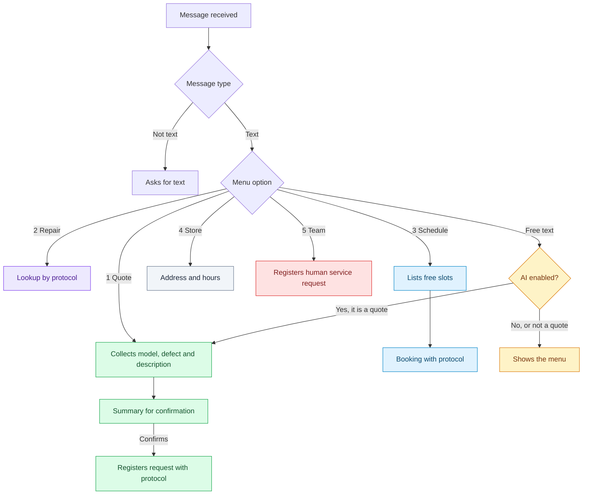
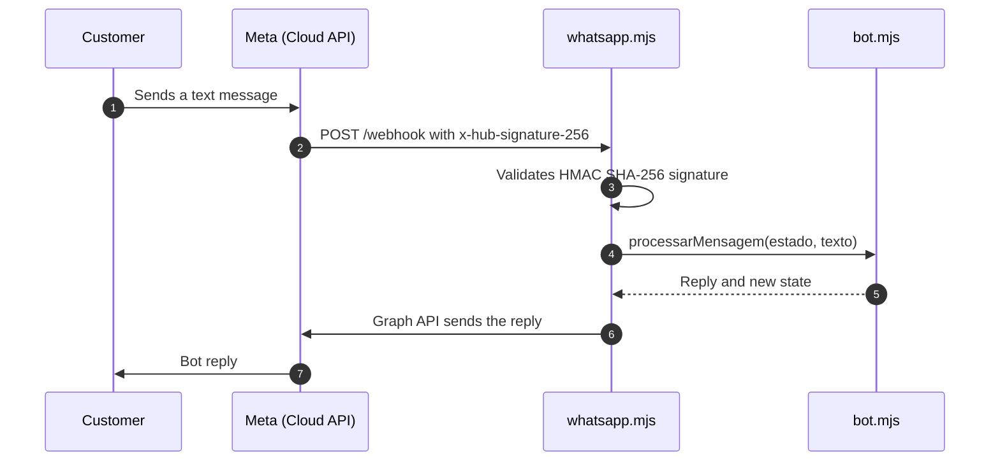
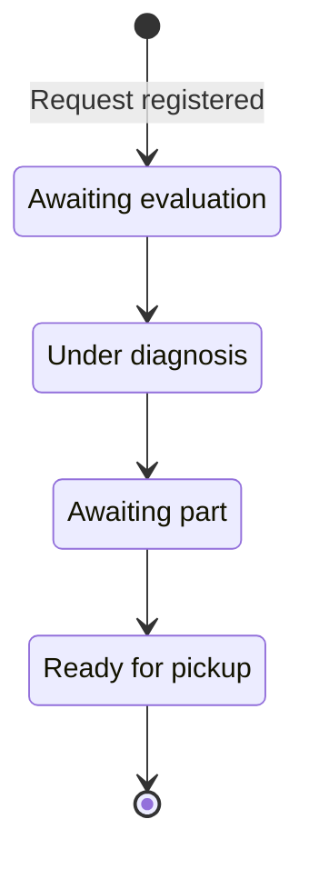
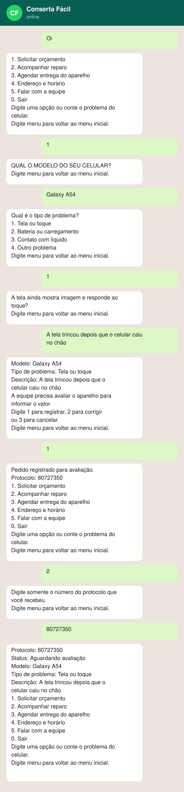

  <b>🌐 Choose your language · Escolha o idioma</b>  
  
  

---

# EasyFix | WhatsApp Customer Service Chatbot

  
  
  
  

  
  
  

  
  
  
  
  

  Customer service chatbot for a phone repair shop, with flows for quotes, repair tracking, delivery scheduling,
  store information and handoff to the team. It runs on the official WhatsApp API and can interpret free-text
  messages with AI.

  <a href="#-overview">Overview</a> •
  <a href="#-project-map">Map</a> •
  <a href="#️-features">Features</a> •
  <a href="#-service-flow">Flow</a> •
  <a href="#️-architecture">Architecture</a> •
  <a href="#-technical-decisions">Technical decisions</a> •
  <a href="#-simulated-conversation">Simulated conversation</a> •
  <a href="#️-technologies">Technologies</a>

---

## 📌 Overview

**EasyFix** (originally *Conserta Fácil*) is a portfolio project that simulates the first-line customer service of a
phone repair shop. The customer chats on WhatsApp, requests a quote, tracks a repair, books a delivery slot and is
handed off to the team when needed. All store, device and customer data is fictitious.

> [!NOTE]
> The bot talks to customers in Portuguese, since it targets a Brazilian shop. The code, flows and decisions are
> described here in English.

| ❌ Problem | 💡 Solution | ✅ Result |
|---|---|---|
| Quote requests arrive outside business hours and without a standard set of information. | Guided flow that collects model, defect type and description before registering the request. | Every request reaches the team complete, with a protocol number. |
| The customer has to message the shop to ask about repair progress. | Status lookup by protocol number, restricted to the sender who made the request. | Repair information available without team intervention. |
| Scheduling a delivery takes several messages until a free slot is found. | List of available slots; a booked slot is no longer offered. | Booking confirmed with a protocol number in a few steps. |
| Customers describe the problem in free text, in many different ways. | AI extracts model, defect and description; the bot asks only for what is missing and shows a summary for confirmation. | Registration only after the customer's explicit confirmation. |

## 🧠 Project map

## ⚙️ Features

| Feature | Behavior |
|---|---|
| **Request a quote** | Collects model, defect type and description, shows a summary and registers the request after confirmation. The price is set by the team after evaluating the device. |
| **Track a repair** | Looks up the status, model and description of a request from its protocol number, only for the sender who created it. |
| **Schedule a delivery** | Offers up to three free slots on the next business days. Each slot can be booked only once. |
| **Address and hours** | Shows the store's reference location and business hours. |
| **Talk to the team** | Registers a request for human service with the subject given by the customer. |
| **AI interpretation** | When enabled, identifies quote intent in a free-text message and extracts the device data. |

## 🔄 Service flow

## 🏗️ Architecture

Sequence of a message, from the customer's phone to the bot's reply:

Planned status cycle for each registered request:

Components:

| Module | Responsibility |
|---|---|
| `bot.mjs` | Conversation state machine, rules for each step and request registration. |
| `whatsapp.mjs` | Receiving webhook events, signature validation, delivery control and sending replies. |
| `triagem.mjs` | Call to the OpenAI API with JSON Schema output, to extract data from free text. |
| `operacao.mjs` | Slot schedule, with atomic file-based booking. |

## 🧭 Technical decisions

- **Confirmation before registration.** The AI only suggests the data. No request is saved without the customer's confirmation.
- **Pricing outside the bot.** The system does not estimate prices. Evaluating the device is the team's responsibility.
- **Webhook origin validation.** Each event is accepted only with a valid HMAC SHA-256 signature, compared in constant time.
- **Idempotency per message.** Deliveries already sent are not repeated if Meta resends the same event.
- **Per-customer queue.** Messages from the same sender are processed in order, with no crossed replies.
- **Fallback without AI.** If the API is unavailable or not configured, the guided flow keeps working.
- **Minimal dependencies.** The project uses only Node.js built-in modules.
- **Data outside the repository.** Requests, bookings and credentials are kept locally and excluded from version control.

## 💬 Simulated conversation

The conversation below includes a quote request, confirmation, protocol number and lookup (in Portuguese, as the
customer would see it). It goes through the same signed webhook Meta would use, without calling the API.

  

Simulation details in [SIMULACAO.md](SIMULACAO.md) (in Portuguese).

## 🛠️ Technologies

| Category | Technologies |
|---|---|
| Language and runtime | JavaScript (ES Modules), Node.js |
| Integration | WhatsApp Cloud API (Meta), webhooks, Graph API |
| AI | OpenAI Responses API, structured output with JSON Schema |
| Security | HMAC SHA-256, constant-time comparison |
| Storage | JSON Lines files and file-based schedule |
| Diagrams | Mermaid |
| Version control | Git, GitHub |

  🌐 <a href="README.pt-BR.md">Ler esta página em português</a>

