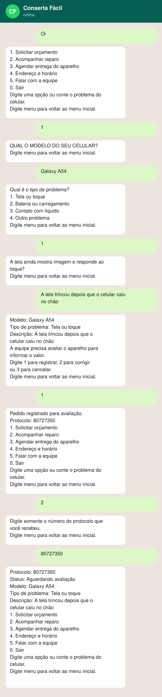

# Simulação de conversa — Conserta Fácil

A imagem abaixo é gerada por `simulacao.mjs` e mostra a conversa completa: pedido de orçamento, confirmação, protocolo e consulta.

  

O fluxo passa pelo webhook com assinatura HMAC SHA-256, o mesmo caminho que a Meta usaria. A API não é chamada.
